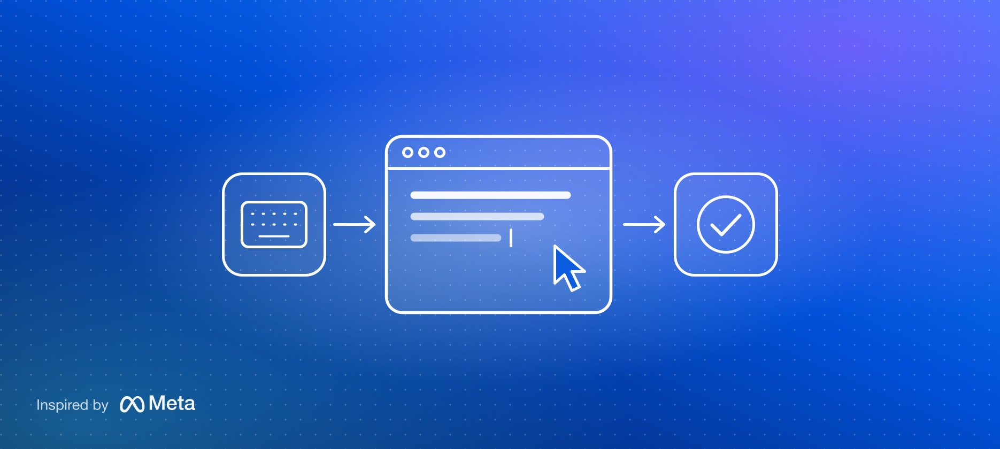
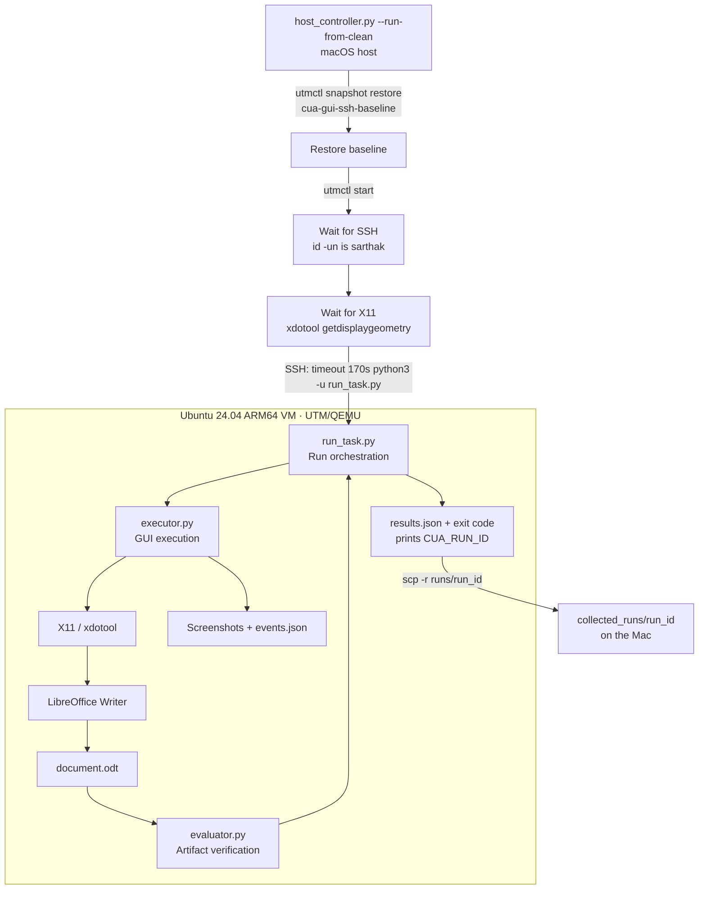
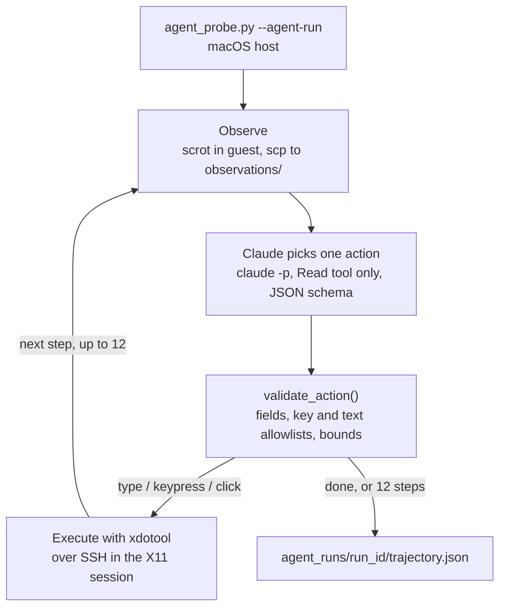

# Building Computer-use Agents from Scratch

<a href="https://engineering.sarthak.pro/engineering/computer-use-agents-from-scratch">
  
</a>

In this repo, I'm documenting going from zero to hero with Computer Use Agents, simulating the role of a Research Engineer / SWE.

> [!IMPORTANT]
> ### [Start with the engineering write-up →](https://engineering.sarthak.pro/engineering/computer-use-agents-from-scratch)
>
> **[Building computer-use agents from scratch, inspired by Meta's Muse](https://engineering.sarthak.pro/engineering/computer-use-agents-from-scratch)** is the companion post to this repo. This README covers how to run the code. The write-up explains why it's built this way and what went wrong along the way: the VM setup, the executor/evaluator split, the injected faults, moving VM control to the host, the guest/host timeouts and the code review that shaped them, one-command runs from a clean snapshot, and the first agent loop where Claude picks each action.
>
> It includes a screen recording of the agent running, diagrams of each stage, and a build log of every issue and pull request. I'm updating it live as the project moves.

## Overview

The project covers two parts of computer-use evaluation: **executing actions in a desktop environment** and **checking whether the resulting artifact satisfies the task**. Keeping these stages separate makes it easier to investigate failures in either one.

The task launches LibreOffice Writer in an Ubuntu VM, enters a specified sentence through simulated keyboard input, saves an `.odt` document **through the GUI**, and checks the document contents against the expected text.

There are two policies for the same task:

- **Scripted (reference).** `executor.py` performs a fixed sequence of GUI actions. `host_controller.py --run-from-clean` restores a clean snapshot, boots the VM, waits until it's ready, runs the task and evaluator over SSH, and copies the results back to the Mac.
- **Model-driven (v1).** `agent_probe.py --agent-run` runs a bounded loop where Claude looks at a screenshot of the desktop and returns one structured action, which Python validates and executes with `xdotool`. This is an early first version on one small task. The evaluator doesn't check its output yet.

The limited task scope allows focused testing of environment setup, GUI compatibility, process failures, observability, state contamination, and evaluation correctness.

## Architecture

### Clean scripted run



### v1 agent loop



| Module | Where it runs | Responsibility |
| --- | --- | --- |
| `host_controller.py` | macOS host | Restores the baseline snapshot and starts the VM (`--reset-vm`, `--run-from-clean`), waits for SSH and X11 readiness, runs `run_task.py` in the guest under guest- and host-side time limits, copies the run directory to `collected_runs/`, and exits with the experiment's exit code. |
| `agent_probe.py` | macOS host | v1 agent loop: captures screenshots from the guest, asks Claude for one structured action per step, validates and executes it over SSH, and saves a trajectory. |
| `run_task.py` | Guest | Assigns a unique run ID, prints it as `CUA_RUN_ID=...`, creates the output directory, runs execution then evaluation, writes `results.json`, and exits `0` only on end-to-end success. |
| `executor.py` | Guest | Scripted policy: launches Writer, locates and activates its window, issues keyboard actions, saves the document, and records screenshots/events. |
| `evaluator.py` | Guest | Opens the generated ODT as a ZIP archive, parses `content.xml`, and compares document paragraphs against the expected text. |
| `exceptions.py` | Guest | Defines `ExecutorError` and `EvaluationError` so each stage's failures are classified separately. |
| `scratch.py` | Either | Personal prototyping file, kept in history on purpose as a learning record, it's not part of the harness. |

**Module contract:** the executor either produces an output artifact or raises `ExecutorError`. The evaluator checks the artifact against the task requirements or raises `EvaluationError`. The orchestrator coordinates both stages, records the outcome in `results.json`, and returns a nonzero exit code on any failure. The host controller adds the remote layer: it starts every run from the same snapshot, reports whether a run finished, hit its time limit, or was lost to an SSH failure, and keeps the run's artifacts on the host.

## What works today

- [x] Provision an Ubuntu 24.04.5 LTS ARM64 desktop VM using UTM/QEMU on Apple Silicon.
- [x] Create a clean VM snapshot and verify that restoring it removes a test-file modification.
- [x] Configure a working X11 session after investigating a Wayland/Xorg compatibility issue.
- [x] Control mouse/keyboard input through `xdotool` and capture desktop screenshots with `scrot`.
- [x] Open LibreOffice Writer, enter text, and save an ODT document using GUI automation.
- [x] Independently verify a saved ODT's contents using Python's standard-library ZIP and XML tools.
- [x] Separate execution, evaluation, and orchestration into distinct Python modules.
- [x] Persist a per-run `results.json` with a status, error details, and `end_to_end_success`, and exit nonzero on failure.
- [x] Validate both fault-injection cases manually (wrong document content, executor failure). See [#2](https://github.com/gsarthakdev/cua-learning/issues/2).
- [x] Run commands in the guest from the host over SSH as a non-root user, with `utmctl` kept for VM lifecycle only. See [#8](https://github.com/gsarthakdev/cua-learning/issues/8), [#9](https://github.com/gsarthakdev/cua-learning/issues/9).
- [x] Run the full task and evaluation from the host, with guest- and host-side timeouts. See [#6](https://github.com/gsarthakdev/cua-learning/issues/6), [PR #10](https://github.com/gsarthakdev/cua-learning/pull/10).
- [x] Copy each run's artifacts from the guest to the host so they survive a snapshot restore. See [#13](https://github.com/gsarthakdev/cua-learning/issues/13), [PR #14](https://github.com/gsarthakdev/cua-learning/pull/14).
- [x] Restore a disk-only baseline snapshot and boot the VM from the host. See [#15](https://github.com/gsarthakdev/cua-learning/issues/15), [PR #16](https://github.com/gsarthakdev/cua-learning/pull/16).
- [x] Wait for SSH and X11 readiness after boot instead of checking once. See [#17](https://github.com/gsarthakdev/cua-learning/issues/17), [PR #18](https://github.com/gsarthakdev/cua-learning/pull/18).
- [x] Run a full clean episode with one command, `--run-from-clean`. See [#19](https://github.com/gsarthakdev/cua-learning/issues/19), [PR #20](https://github.com/gsarthakdev/cua-learning/pull/20).
- [x] Run a bounded agent loop where Claude chooses each GUI action from a screenshot, with a saved trajectory per run. See [#21](https://github.com/gsarthakdev/cua-learning/issues/21), [PR #22](https://github.com/gsarthakdev/cua-learning/pull/22).

## Environment and setup

Tested locally with:

| Component | Development setup |
| --- | --- |
| Host | macOS on Apple Silicon |
| Virtualization | UTM / QEMU, controlled with `utmctl` |
| Guest | Ubuntu 24.04.5 LTS, ARM64 (`aarch64`) |
| Python | 3.12.x |
| Desktop | GNOME on **X11** |
| GUI tools | `xdotool`, `scrot` |
| Target application | LibreOffice Writer |
| Host-to-guest channel | SSH and `scp` with a dedicated ed25519 key |
| Model (agent loop) | Claude Haiku through the Claude Code CLI (`claude -p`) |

The executor runs **inside the Ubuntu desktop session** and requires an interactive X11 display. macOS hosts the VM and starts experiments, but it does not run the GUI automation directly. Wayland, headless displays, and other Linux distributions have not been validated.

The guest-side harness (`run_task.py`, `executor.py`, `evaluator.py`) and `host_controller.py` use only the standard library. `agent_probe.py` also needs Pillow and the Claude Code CLI on the host. Runs interact with the visible desktop, so manual mouse or keyboard input during a run can interfere with the result.

### Guest setup (Ubuntu VM)

```bash
sudo apt update
sudo apt install -y xdotool scrot libreoffice-writer openssh-server

# Optional: QEMU guest agent, needed for `utmctl ip-address` / `utmctl exec`.
sudo apt install -y qemu-guest-agent
sudo systemctl enable --now qemu-guest-agent

# Confirm the desktop session uses X11.
echo "$XDG_SESSION_TYPE"  # expected: x11
xdotool getdisplaygeometry

# Clone the repo where the host controller expects it.
git clone https://github.com/gsarthakdev/cua-learning ~/cua-learning
```

The VM has to reach a logged-in X11 desktop and a running `sshd` on its own after a boot (for example, with automatic login), because the controller restores a snapshot and boots the VM without logging in.

### Baseline snapshot

With the VM set up as above and **stopped**, take a disk-only snapshot in UTM named `cua-gui-ssh-baseline` (the name is `BASELINE_SNAPSHOT` in `host_controller.py`). A disk-only snapshot means every run gets a real boot, with no processes or application state carried over from before the snapshot. The cost is that a freshly booted VM isn't ready right away, which is what the readiness checks handle. See [#15](https://github.com/gsarthakdev/cua-learning/issues/15) for the reasoning.

### Host setup (macOS)

```bash
# Dedicated key for the controller, authorized in the guest.
ssh-keygen -t ed25519 -f ~/.ssh/cua_learning_ed25519
ssh-copy-id -i ~/.ssh/cua_learning_ed25519.pub sarthak@<guest-ip>

# Find the VM's ID and IP.
/Applications/UTM.app/Contents/MacOS/utmctl list
/Applications/UTM.app/Contents/MacOS/utmctl ip-address <VM_ID>

# For the agent loop only.
python3 -m venv .venv && source .venv/bin/activate
pip install pillow
claude --version   # Claude Code CLI, installed and logged in
```

Then set `VM_ID`, `SSH_TARGET`, `GUEST_RUNNER`, and `GUEST_RUNS_DIR` at the top of `host_controller.py`. The GUI environment (`DISPLAY=:0`, `XAUTHORITY=/run/user/1000/gdm/Xauthority`, `XDG_RUNTIME_DIR`, and the D-Bus address) assumes the guest user is UID 1000 on a GDM Xorg session.

Run the host scripts from the regular macOS Terminal. `utmctl` commands fail from the VS Code integrated terminal, which macOS treats as a different app requesting control of UTM.

## Running an experiment

**Clean run (normal path).** Shut the VM down first, then:

```bash
python3 host_controller.py --run-from-clean
echo $?
```

This runs one full episode:

1. Restore the `cua-gui-ssh-baseline` snapshot. This refuses to run unless `utmctl status` reports `stopped`.
2. Start the VM with `utmctl start`.
3. `wait_for_ssh()`: run `id -un` over SSH every 2 seconds (8 s per attempt, 90 s in total) until it succeeds and returns `sarthak`.
4. `wait_for_gui()`: run `xdotool getdisplaygeometry` through the GUI environment on the same schedule (120 s in total) until it returns two positive integers.
5. Run `run_task.py` in the guest under `timeout --signal=TERM --kill-after=5s 170s python3 -u`.
6. Read the `CUA_RUN_ID=...` line from the guest's output and copy `runs/<run_id>` to `collected_runs/<run_id>` on the Mac with `scp -r`.
7. Exit with the experiment's exit code.

If a readiness check runs out of time, it raises an error that includes the last failure it saw. The VM is left running after a run, so shut it down before the next `--run-from-clean`.

**Other modes.**

```bash
python3 host_controller.py --reset-vm   # restore the baseline and start the VM only
python3 host_controller.py              # run on an already running, ready VM (steps 3 to 7)
```

**Inside the guest (debugging).** From a terminal in the Ubuntu desktop session:

```bash
cd ~/cua-learning
python3 run_task.py
echo $?
```

### Timeouts and exit codes

A remote run has two independent time limits. The guest limit is enforced inside Ubuntu by GNU `timeout`, so it stops the run even if the SSH connection is gone. The host limit only fires when SSH itself hangs. Killing the local `ssh` process alone would leave `run_task.py` typing into Writer in the guest, and the next run's window search could pick up that leftover window.

| Exit code | Meaning |
| --- | --- |
| `0` | Task executed and the evaluator passed. |
| `1` | Run finished but failed: wrong document, executor error, evaluator error, or harness error. See `results.json`. |
| `124` (guest) | `run_task.py` hit its 170 s limit and stopped on SIGTERM. |
| `137` | `run_task.py` ignored SIGTERM and was killed with SIGKILL 5 s later. |
| `255` | SSH failure. The state of the remote run is unknown. |
| `124` (host) | The SSH process exceeded the host's 200 s limit. The controller prints any captured output, cannot confirm the remote run stopped, and skips artifact collection. |

## Running the agent loop

With the VM running and its desktop logged in (for example after `--reset-vm`):

```bash
source .venv/bin/activate
python3 agent_probe.py --agent-run
echo $?
```

Each run creates a run ID and a directory in the guest for the document, then repeats up to 12 times:

1. Check that the VM is started, wait for SSH and X11, take a screenshot with `scrot` in the guest, copy it to `observations/` on the Mac, and delete the guest copy.
2. Ask Claude for one action. The call uses `claude -p` with `--model haiku`, `--json-schema` for the action, only the `Read` tool (to open the screenshot), MCP tools disallowed, and at most 3 turns. The prompt includes the screen size, the coordinate system, the target document path, and the list of earlier actions.
3. Validate the action, then execute it with `xdotool` over SSH, and wait one second.

The loop ends when Claude returns `done` or after 12 steps. Each step's screenshot path and action are saved to `agent_runs/<run_id>/trajectory.json` on the Mac in a `finally` block, so a run that fails still leaves its record.

**Action space.** Every action has the same five fields (`action`, `text`, `key`, `x`, `y`), with unused ones set to `""` or `0`:

| Action | Effect |
| --- | --- |
| `type` | Type `text` into the focused field. |
| `keypress` | Press `key`. |
| `click` | Left-click at (`x`, `y`) in screenshot coordinates. |
| `done` | Claude believes the task is complete. Nothing is executed. |

**Guardrails.** Claude proposes and Python decides what runs. Claude never gets a shell. `validate_action()` rejects unexpected fields and wrong types. `keypress` is limited to Return, Escape, Tab, `ctrl+n`, `ctrl+s`, `ctrl+shift+s`, and `ctrl+l`. In this first version, `type` may only enter the expected sentence or the target document path.

**Statuses and exit code.**

| `status` in `trajectory.json` | Meaning |
| --- | --- |
| `agent_declared_done` | Claude returned `done`. Exit `0`. This is Claude's claim, not a pass: the evaluator doesn't check the agent's document yet. |
| `max_steps_exceeded` | 12 steps without `done`. Exit `1`. |
| `agent_error` | An action failed validation or execution, or a Claude call failed. The error is saved and the exception is re-raised. |
| `running` | The run was interrupted (for example with Ctrl+C) before it set a final status. |

## Execution and evaluation

Each scripted run creates a unique directory under `runs/` in the guest, and the host keeps copies and agent records:

```text
cua-learning/
├── host_controller.py
├── agent_probe.py
├── run_task.py
├── executor.py
├── evaluator.py
├── exceptions.py
├── runs/                          # in the guest
│   └── <timestamp>-<short-id>/
│       ├── before.png
│       ├── after_typing.png
│       ├── after_save.png
│       ├── document.odt
│       ├── events.json
│       ├── results.json
│       └── evaluation_log.json    # skipped when the executor fails
├── collected_runs/                # on the Mac, copied from runs/ after each run
│   └── <timestamp>-<short-id>/
├── agent_runs/                    # on the Mac, one per agent run
│   └── <timestamp>-<short-id>/
│       └── trajectory.json
└── observations/                  # on the Mac, screenshots the agent saw
    └── <uuid>.png
```

Screenshots record the visible desktop state. `events.json` records timestamped actions, with each command logged before it runs so the last event of a failed run is the command that failed. The saved `.odt` document is the **task artifact** used for outcome verification.

The evaluator checks that the file exists, that it is a valid ZIP-based ODT, that the archive members are readable, and that the document paragraphs equal exactly the expected single paragraph. An earlier substring check was replaced because it would pass a document with extra content.

`results.json` is the run-level record:

```json
{
  "run_id": "20261027-153012-a1b2c3",
  "task_name": "UsingDoc",
  "executor_completed": true,
  "evaluation_completed": true,
  "evaluation_success": true,
  "end_to_end_success": true,
  "status": "completed"
}
```

On failure, `status` becomes `executor_failed`, `evaluation_failed`, or `harness_failed`, and `error_type` and `error_message` are added. A run with a wrong document completes with `evaluation_success: false`.

## Failure testing

Two controlled faults were injected one at a time, verified, and reverted ([#2](https://github.com/gsarthakdev/cua-learning/issues/2)):

| Case | Injection | Observed result |
| --- | --- | --- |
| Happy path | Correct text, saved successfully | `end_to_end_success: true`, exit `0` |
| Incorrect output | Type a different sentence but still save a valid ODT | `evaluation_success: false`, exit `1` |
| Execution error | Introduce a failure inside the executor | `status: executor_failed`, evaluation skipped, exit `1` |

The executor-failure case exposed a bug in `run_task.py`: its `finally` block tried to write evaluator output that never existed. It now skips `evaluation_log.json` when the executor fails. After reverting both faults, the original task passed again in a fresh run directory. **These are manual tests and not yet automated regressions.**

## Review workflow

Changes go through issues and pull requests, with design decisions written down in the issue as they're made:

- [#3](https://github.com/gsarthakdev/cua-learning/issues/3): ChatGPT reviewed the harness before fault injection. Its findings led to explicit exit codes, exception chaining with `from error`, and the injection order.
- [PR #11](https://github.com/gsarthakdev/cua-learning/pull/11) added `.github/workflows/claude.yml`, which runs Claude Code when `@claude` is mentioned in an issue or PR.
- [PR #10](https://github.com/gsarthakdev/cua-learning/pull/10) was reviewed by Claude with inline comments. The fixes include the guest/host timeouts, the SIGKILL `137` case, checked SSH exit codes, and `utmctl` errors that keep stderr. Findings not worth fixing yet go to the backlog in [#12](https://github.com/gsarthakdev/cua-learning/issues/12).
- [#15](https://github.com/gsarthakdev/cua-learning/issues/15) records why the baseline snapshot is disk-only, and [#21](https://github.com/gsarthakdev/cua-learning/issues/21) records the agent loop's trade-offs.

## Design decisions and known limitations

- **Scripted reference policy.** Fixed actions make desktop and runtime issues easier to reproduce, so the harness was tested with a script before a model chose any actions. The scripted path is still the reference for comparing the agent.
- **Independent modules.** GUI execution and document verification have separate interfaces, so the interaction mechanism can change without rewriting the outcome check.
- **Run-specific output paths.** Each run gets a unique directory so an earlier document cannot inadvertently satisfy a later evaluation.
- **Execution evidence and artifact checks.** Screenshots, event logs, and trajectories support debugging; the saved ODT content determines task correctness.
- **SSH for commands, `utmctl` for lifecycle.** `utmctl exec` ran commands as root and intermittently returned empty output, so commands moved to SSH as the regular user.
- **Disk-only snapshot and readiness polling.** Every run boots from the same disk, and the controller waits for SSH and X11 instead of assuming the VM is ready when UTM reports it started.
- **Artifacts leave the guest.** Restoring a snapshot wipes the guest's `runs/`, so each run directory is copied to the host first.
- **Claude decides, Python executes.** Claude returns one schema-checked action per call and never gets a shell. One action per call is slower and costs more than planning ahead, but the model sees what actually happened before choosing the next step.
- **`done` is not success.** Claude saying the task is complete doesn't show the document exists or is correct. The saved `.odt` has to pass the evaluator, which isn't wired into the agent loop yet.
- **Narrow action allowlists.** The `type` and `keypress` allowlists only fit this one task. They will have to become a real policy before the agent can take on other tasks.
- **History as text.** Each `claude -p` call starts fresh, so earlier actions are passed back in the prompt. That works for a 12-step task but will grow with longer ones.
- **VM isolation and trust boundary.** UTM provides virtualization between the Ubuntu guest and macOS host. The executor and evaluator still share the **same guest**, leaving evaluator code and results exposed to modification by an adversarial agent with sufficient access. Today the agent's narrow action space keeps it away from them.
- **Timed-out runs leave no record.** SIGTERM ends Python without running `finally` blocks, so a run stopped by the guest timeout writes neither `results.json` nor `events.json`. Separately, `run_task.py` can raise `NameError` in its `finally` block when a run stops before evaluation for a reason other than an executor failure.
- **Hardcoded host configuration.** The guest IP, UID 1000, and the GDM Xauthority path are constants. The IP is assigned by DHCP and can change after a snapshot restore or host reboot.
- **Manual shutdown between runs.** `--run-from-clean` needs a stopped VM, and nothing powers the VM off after a run yet.
- **GUI timing and focus dependencies.** Window-title matching, focus management, and fixed sleeps can fail when application state or launch times change. The executor takes the last matching Writer window, which breaks if an earlier run left one open.
- **Limited coverage.** Testing currently covers one task in one interactive VM. There is no concurrent rollout scheduler, broad task suite, RL training loop, or measured success rate for the agent.

## Roadmap

- [x] Start the VM and restore a clean snapshot from the host before each run, then wait until it's ready.
- [x] Copy each run directory back to the host.
- [x] Introduce model-driven observation/action selection while preserving the executor/evaluator boundary.
- [ ] Run the evaluator on the agent's saved document, so an agent run ends in a pass or fail instead of Claude's own `done`.
- [ ] Move evaluation out of the agent-controlled guest and run it on the collected artifact.
- [ ] Power the VM off after each run, then run the agent many times from clean snapshots and measure its success rate.
- [ ] Give interrupted agent runs their own status instead of `running`.
- [ ] Look up the guest IP with `utmctl ip-address` and derive GUI paths from the guest user's UID.
- [ ] Handle SIGTERM in `run_task.py` so timed-out runs still write `results.json` and `events.json`; guard the evaluation log against runs that stop before evaluation.
- [ ] Reuse one SSH connection per run (`ControlMaster`) and stream experiment output instead of holding it until the end.
- [ ] Scope event collection to a single run, and replace fixed sleeps with condition-based waits and stronger focus/dialog checks.
- [ ] Turn the fault-injection cases into repeatable regression tests.
- [ ] Add more applications and outcome-based task evaluators, and widen the action allowlists into a real policy.

## Read the full write-up

The reasoning behind each decision above, the failures that led to it, and a recording of the agent running are in the companion post:

**[Building computer-use agents from scratch, inspired by Meta's Muse →](https://engineering.sarthak.pro/engineering/computer-use-agents-from-scratch)**
