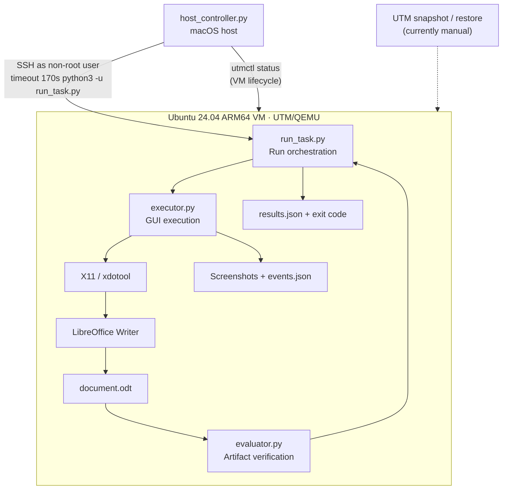

# Building Computer-use Agents from Scratch

<a href="https://engineering.sarthak.pro/engineering/computer-use-agents-from-scratch">
  
</a>

In this repo, I'm documenting going from zero to hero with Computer Use Agents, simulating the role of a Research Engineer / SWE.

> **Read the write-up:** [Building computer-use agents from scratch, inspired by Meta's Muse](https://engineering.sarthak.pro/engineering/computer-use-agents-from-scratch). It's the companion post to this repo and walks through the VM setup, the executor/evaluator split, the injected faults, moving VM control from the guest to the host, the guest/host timeouts, and the code review that shaped them. I'm updating it live as I'm engineering this project.

## Overview

The project covers two parts of computer-use evaluation: **executing actions in a desktop environment** and **checking whether the resulting artifact satisfies the task**. Keeping these stages separate makes it easier to investigate failures in either one.

The initial task launches LibreOffice Writer in an Ubuntu VM, enters a specified sentence through simulated keyboard input, saves an `.odt` document **through the GUI**, and checks the document contents against the expected text.

Experiments are started from the macOS host. `host_controller.py` checks the VM and the guest's desktop session, then runs the harness inside the VM over SSH with a time limit on both sides.

The limited task scope allows focused testing of environment setup, GUI compatibility, process failures, observability, state contamination, and evaluation correctness before introducing autonomous action selection.

## Architecture



| Module | Where it runs | Responsibility |
| --- | --- | --- |
| `host_controller.py` | macOS host | Checks the VM is started with `utmctl`, verifies SSH, the guest user, and X11 access, then runs `run_task.py` in the guest under guest- and host-side time limits and reports how the run ended. |
| `run_task.py` | Guest | Assigns a unique run ID, creates the output directory, runs execution then evaluation, writes `results.json`, and exits `0` only on end-to-end success. |
| `executor.py` | Guest | Launches Writer, locates and activates its window, issues keyboard actions, saves the document, and records screenshots/events. |
| `evaluator.py` | Guest | Opens the generated ODT as a ZIP archive, parses `content.xml`, and compares document paragraphs against the expected text. |
| `exceptions.py` | Guest | Defines `ExecutorError` and `EvaluationError` so each stage's failures are classified separately. |
| `scratch.py` | Either | Personal prototyping file, kept in history on purpose as a learning record, it's not part of the harness. |

**Module contract:** the executor either produces an output artifact or raises `ExecutorError`. The evaluator checks the artifact against the task requirements or raises `EvaluationError`. The orchestrator coordinates both stages, records the outcome in `results.json`, and returns a nonzero exit code on any failure. The host controller adds the remote layer: it reports whether a run finished, hit its time limit, or was lost to an SSH failure.

## What works today

- [x] Provision an Ubuntu 24.04.5 LTS ARM64 desktop VM using UTM/QEMU on Apple Silicon.
- [x] Create a clean VM snapshot and verify that restoring it removes a test-file modification.
- [x] Configure a working X11 session after investigating a Wayland/Xorg compatibility issue.
- [x] Control mouse/keyboard input through `xdotool` and capture desktop screenshots with `scrot`.
- [x] Open LibreOffice Writer, enter text, and save an ODT document using GUI automation.
- [x] Independently verify a saved ODT's contents using Python's standard-library ZIP and XML tools.
- [x] Separate execution, evaluation, and orchestration into distinct Python modules.
- [x] Persist a per-run `results.json` with a status, error details, and `end_to_end_success`, and exit nonzero on failure.
- [x] Validate both fault-injection cases manually (wrong document content, executor failure). See [#2](https://github.com/gsarthakdev/cua-learning/issues/2).
- [x] Run commands in the guest from the host over SSH as a non-root user, with `utmctl` kept for VM lifecycle only. See [#8](https://github.com/gsarthakdev/cua-learning/issues/8), [#9](https://github.com/gsarthakdev/cua-learning/issues/9).
- [x] Run the full task and evaluation from the host, with guest- and host-side timeouts. See [#6](https://github.com/gsarthakdev/cua-learning/issues/6), [PR #10](https://github.com/gsarthakdev/cua-learning/pull/10).

## Environment and setup

Tested locally with:

| Component | Development setup |
| --- | --- |
| Host | macOS on Apple Silicon |
| Virtualization | UTM / QEMU, controlled with `utmctl` |
| Guest | Ubuntu 24.04.5 LTS, ARM64 (`aarch64`) |
| Python | 3.12.x |
| Desktop | GNOME on **X11** |
| GUI tools | `xdotool`, `scrot` |
| Target application | LibreOffice Writer |
| Host-to-guest channel | SSH with a dedicated ed25519 key |

The executor runs **inside the Ubuntu desktop session** and requires an interactive X11 display. macOS hosts the VM and starts experiments, but it does not run the GUI automation directly. Wayland, headless displays, and other Linux distributions have not been validated.

Python dependencies are limited to the standard library; no `pip` installation is required. The script interacts with the visible Writer window, so manual mouse or keyboard input during a run can interfere with the result.

### Guest setup (Ubuntu VM)

```bash
sudo apt update
sudo apt install -y xdotool scrot libreoffice-writer openssh-server

# Optional: QEMU guest agent, needed for `utmctl ip-address` / `utmctl exec`.
sudo apt install -y qemu-guest-agent
sudo systemctl enable --now qemu-guest-agent

# Confirm the desktop session uses X11.
echo "$XDG_SESSION_TYPE"  # expected: x11
xdotool getdisplaygeometry

# Clone the repo where the host controller expects it.
git clone https://github.com/gsarthakdev/cua-learning ~/cua-learning
```

### Host setup (macOS)

```bash
# Dedicated key for the controller, authorized in the guest.
ssh-keygen -t ed25519 -f ~/.ssh/cua_learning_ed25519
ssh-copy-id -i ~/.ssh/cua_learning_ed25519.pub sarthak@<guest-ip>

# Find the VM's ID and IP.
/Applications/UTM.app/Contents/MacOS/utmctl list
/Applications/UTM.app/Contents/MacOS/utmctl ip-address <VM_ID>
```

Then set `VM_ID`, `SSH_TARGET`, and `GUEST_RUNNER` at the top of `host_controller.py`. The GUI environment (`DISPLAY=:0`, `XAUTHORITY=/run/user/1000/gdm/Xauthority`, `XDG_RUNTIME_DIR`, and the D-Bus address) assumes the guest user is UID 1000 on a GDM Xorg session.

Run `host_controller.py` from the regular macOS Terminal. `utmctl` commands fail from the VS Code integrated terminal, which macOS treats as a different app requesting control of UTM.

## Running an experiment

**From the host (normal path).** Start the VM and log in to the desktop, then:

```bash
python3 host_controller.py
echo $?
```

The controller runs these checks in order and stops at the first failure with a specific message:

1. `utmctl status` reports `started`.
2. `uname -s` succeeds over SSH (connection, key, and user are working).
3. `id -un` reports the guest user the commands run as.
4. `xdotool getdisplaygeometry` returns a resolution through the GUI environment (the desktop session is reachable).
5. `run_task.py` runs in the guest under `timeout --signal=TERM --kill-after=5s 170s python3 -u`.

**Inside the guest (debugging).** From a terminal in the Ubuntu desktop session:

```bash
cd ~/cua-learning
python3 run_task.py
echo $?
```

### Timeouts and exit codes

A remote run has two independent time limits. The guest limit is enforced inside Ubuntu by GNU `timeout`, so it stops the run even if the SSH connection is gone. The host limit only fires when SSH itself hangs. Killing the local `ssh` process alone would leave `run_task.py` typing into Writer in the guest, and the next run's window search could pick up that leftover window.

| Exit code | Meaning |
| --- | --- |
| `0` | Task executed and the evaluator passed. |
| `1` | Run finished but failed: wrong document, executor error, evaluator error, or harness error. See `results.json`. |
| `124` (guest) | `run_task.py` hit its 170 s limit and stopped on SIGTERM. |
| `137` | `run_task.py` ignored SIGTERM and was killed with SIGKILL 5 s later. |
| `255` | SSH failure. The state of the remote run is unknown. |
| `124` (host) | The SSH process exceeded the host's 200 s limit. The controller prints any captured output and cannot confirm the remote run stopped. |

## Execution and evaluation

Each run creates a unique directory under `runs/` in the guest:

```text
cua-learning/
├── host_controller.py
├── run_task.py
├── executor.py
├── evaluator.py
├── exceptions.py
└── runs/
    └── <timestamp>-<short-id>/
        ├── before.png
        ├── after_typing.png
        ├── after_save.png
        ├── document.odt
        ├── events.json
        ├── results.json
        └── evaluation_log.json   # skipped when the executor fails
```

Screenshots record the visible desktop state. `events.json` records timestamped actions, with each command logged before it runs so the last event of a failed run is the command that failed. The saved `.odt` document is the **task artifact** used for outcome verification.

The evaluator checks that the file exists, that it is a valid ZIP-based ODT, that the archive members are readable, and that the document paragraphs equal exactly the expected single paragraph. An earlier substring check was replaced because it would pass a document with extra content.

`results.json` is the run-level record:

```json
{
  "run_id": "20261027-153012-a1b2c3",
  "task_name": "UsingDoc",
  "executor_completed": true,
  "evaluation_completed": true,
  "evaluation_success": true,
  "end_to_end_success": true,
  "status": "completed"
}
```

On failure, `status` becomes `executor_failed`, `evaluation_failed`, or `harness_failed`, and `error_type` and `error_message` are added. A run with a wrong document completes with `evaluation_success: false`.

## Failure testing

Two controlled faults were injected one at a time, verified, and reverted ([#2](https://github.com/gsarthakdev/cua-learning/issues/2)):

| Case | Injection | Observed result |
| --- | --- | --- |
| Happy path | Correct text, saved successfully | `end_to_end_success: true`, exit `0` |
| Incorrect output | Type a different sentence but still save a valid ODT | `evaluation_success: false`, exit `1` |
| Execution error | Introduce a failure inside the executor | `status: executor_failed`, evaluation skipped, exit `1` |

The executor-failure case exposed a bug in `run_task.py`: its `finally` block tried to write evaluator output that never existed. It now skips `evaluation_log.json` when the executor fails. After reverting both faults, the original task passed again in a fresh run directory. **These are manual tests and not yet automated regressions.**

## Review workflow

Changes go through pull requests with a senior-engineer style review:

- [#3](https://github.com/gsarthakdev/cua-learning/issues/3): ChatGPT reviewed the harness before fault injection. Its findings led to explicit exit codes, exception chaining with `from error`, and the injection order.
- [PR #11](https://github.com/gsarthakdev/cua-learning/pull/11) added `.github/workflows/claude.yml`, which runs Claude Code when `@claude` is mentioned in an issue or PR.
- [PR #10](https://github.com/gsarthakdev/cua-learning/pull/10) was reviewed by Claude with inline comments. The fixes include the guest/host timeouts, the SIGKILL `137` case, checked SSH exit codes, and `utmctl` errors that keep stderr. Findings not worth fixing yet go to the backlog in [#12](https://github.com/gsarthakdev/cua-learning/issues/12).

## Design decisions and known limitations

- **Deterministic execution.** Fixed actions make desktop and runtime issues easier to reproduce. No LLM currently chooses actions.
- **Independent modules.** GUI execution and document verification have separate interfaces, so the interaction mechanism can change without rewriting the outcome check.
- **Run-specific output paths.** Each run gets a unique directory so an earlier document cannot inadvertently satisfy a later evaluation.
- **Execution evidence and artifact checks.** Screenshots and event logs support debugging; the saved ODT content determines task correctness.
- **SSH for commands, `utmctl` for lifecycle.** `utmctl exec` ran commands as root and intermittently returned empty output, so commands moved to SSH as the regular user.
- **VM isolation and trust boundary.** UTM provides virtualization between the Ubuntu guest and macOS host. The executor and evaluator still share the **same guest**, leaving evaluator code and results exposed to modification by an adversarial agent with sufficient access.
- **Timed-out runs leave no record.** SIGTERM ends Python without running `finally` blocks, so a run stopped by the guest timeout writes neither `results.json` nor `events.json`. Separately, `run_task.py` can raise `NameError` in its `finally` block when a run stops before evaluation for a reason other than an executor failure.
- **Hardcoded host configuration.** The guest IP, UID 1000, and the GDM Xauthority path are constants. The IP is assigned by DHCP and can change after a snapshot restore or host reboot.
- **GUI timing and focus dependencies.** Window-title matching, focus management, and fixed sleeps can fail when application state or launch times change. The executor takes the last matching Writer window, which breaks if an earlier run left one open.
- **Manual VM reset.** UTM snapshots have been created and restore-tested. The controller checks that the VM is started but does not start it or restore a snapshot.
- **Limited coverage.** Testing currently covers one task in one interactive VM. There is no concurrent rollout scheduler, broad task suite, RL training loop, or measured performance claim.

## Roadmap

- [ ] Start the VM and restore a clean snapshot from the host before each run, then confirm the restored state.
- [ ] Look up the guest IP with `utmctl ip-address` and derive GUI paths from the guest user's UID.
- [ ] Handle SIGTERM in `run_task.py` so timed-out runs still write `results.json` and `events.json`; guard the evaluation log against runs that stop before evaluation.
- [ ] Copy each run directory back to the host, and move evaluation out of the agent-controlled guest.
- [ ] Reuse one SSH connection per run (`ControlMaster`) and stream experiment output instead of holding it until the end.
- [ ] Scope event collection to a single run, and replace fixed sleeps with condition-based waits and stronger focus/dialog checks.
- [ ] Turn the fault-injection cases into repeatable regression tests.
- [ ] Add more applications and outcome-based task evaluators.
- [ ] Introduce model-driven observation/action selection while preserving the executor/evaluator boundary.

## Engineering focus

The current work focuses on **execution correctness, reproducibility, and failure diagnosis**.
