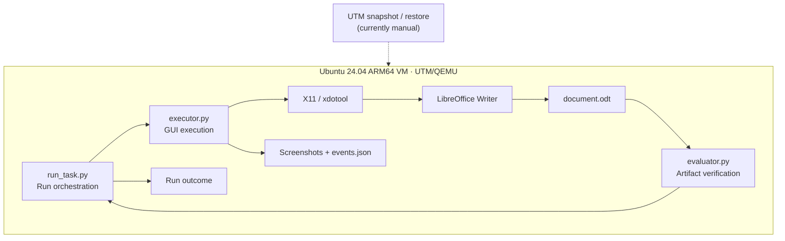

# Computer-Use Evaluation Harness

In this repo, I'm documenting going from zero to hero with Computer Use Agents, simulating the role of a Research Engineer / SWE.

## Overview

The project covers two parts of computer-use evaluation: **executing actions in a desktop environment** and **checking whether the resulting artifact satisfies the task**. Keeping these stages separate makes it easier to investigate failures in either one.

The initial task launches LibreOffice Writer in an Ubuntu VM, enters a specified sentence through simulated keyboard input, saves an `.odt` document **through the GUI**, and checks the document contents against the expected text.

The limited task scope allows focused testing of environment setup, GUI compatibility, process failures, observability, state contamination, and evaluation correctness before introducing autonomous action selection.

## Architecture



| Module | Responsibility |
| --- | --- |
| `run_task.py` | Assigns a unique run ID, creates the output directory, and coordinates execution followed by evaluation. |
| `executor.py` | Launches Writer, locates and activates its window, issues keyboard actions, saves the document, and records screenshots/events. |
| `evaluator.py` | Opens the generated ODT as a ZIP archive, parses `content.xml`, and compares document paragraphs against the expected text. |
| `exceptions.py` | Defines `ExecutorError` to surface failures from the execution stage. |

**Module contract:** the executor either produces an output artifact or raises an error. The evaluator checks the artifact against the task requirements. The orchestrator coordinates both stages and reports the overall outcome. Failure classification and consistent process exit codes are still being implemented.

## What works today

The following milestones have been exercised manually on the development VM:

- [x] Provision an Ubuntu 24.04.5 LTS ARM64 desktop VM using UTM/QEMU on Apple Silicon.
- [x] Create a clean VM snapshot and verify that restoring it removes a test-file modification.
- [x] Configure a working X11 session after investigating a Wayland/Xorg compatibility issue.
- [x] Control mouse/keyboard input through `xdotool` and capture desktop screenshots with `scrot`.
- [x] Open LibreOffice Writer, enter text, and save an ODT document using GUI automation.
- [x] Independently verify a saved ODT's contents using Python's standard-library ZIP and XML tools.
- [x] Separate execution, evaluation, and orchestration into distinct Python modules.

The normal execution path has been exercised manually. **Negative-path tests and the persisted end-to-end result contract are still in progress.**

## Environment and setup

Tested locally with:

| Component | Development setup |
| --- | --- |
| Host | macOS on Apple Silicon |
| Virtualization | UTM / QEMU |
| Guest | Ubuntu 24.04.5 LTS, ARM64 (`aarch64`) |
| Python | 3.12.x |
| Desktop | GNOME on **X11** |
| GUI tools | `xdotool`, `scrot` |
| Target application | LibreOffice Writer |

The executor runs **inside the Ubuntu desktop session** and requires an interactive X11 display. macOS hosts the VM; it does not run the GUI automation directly. Wayland, headless displays, and other Linux distributions have not been validated.

```bash
# Run inside the Ubuntu VM, in its graphical desktop session.
sudo apt update
sudo apt install -y xdotool scrot libreoffice-writer

# Confirm this shell belongs to an X11 session.
echo "$XDG_SESSION_TYPE"  # expected: x11
xdotool getdisplaygeometry

# From the repository directory:
cd ~/cua-learning
python3 run_task.py
```

Python dependencies are limited to the standard library; no `pip` installation is required for the current implementation. The script interacts with the visible Writer window, so manual mouse or keyboard input during a run can interfere with the result.

## Execution and evaluation

A typical run creates a unique directory under `runs/`:

```text
cua-learning/
├── run_task.py
├── executor.py
├── evaluator.py
├── exceptions.py
└── runs/
    └── <timestamp>-<short-id>/
        ├── before.png
        ├── after_typing.png
        ├── after_save.png
        ├── document.odt
        └── events.json
```

Screenshots record the visible desktop state. `events.json` records timestamped actions and any caught execution errors. The saved `.odt` document is the **task artifact** used for outcome verification.

The evaluator checks that the file exists, that it is a valid ZIP-based ODT, that the archive members are readable, and that the extracted document paragraphs match the expected single paragraph. A successful evaluation currently looks like:

```json
{
  "task_name": "UsingDoc",
  "file_exists": true,
  "content_matches": true,
  "success": true
}
```

This is the evaluator's current output. Work is underway to persist a separate per-run `result.json` containing `end_to_end_success`, the failure status, and error details. The orchestrator will also return a nonzero exit code when a run fails.

### Artifact verification

An executor can finish its GUI commands even if Writer saves incorrect content or fails to create a document. The evaluator reads the generated file and checks the document contents, allowing the harness to distinguish completed GUI actions from a correct task result.

## Failure testing (in progress)

The next test cycle introduces two controlled faults: a valid document with incorrect content, and a failure in the executor. These cases will exercise the evaluator and exception-handling paths separately.

| Case | Injection | Expected classification |
| --- | --- | --- |
| Happy path | Correct text, saved successfully | Executor completed; evaluation passed |
| Incorrect output | Type a different sentence but still save a valid ODT | Executor completed; `content_matches: false` |
| Execution error | Trigger an invalid GUI command or other known execution failure | `ExecutorError`; evaluation skipped |

The tests will check that debugging artifacts are preserved, stale output cannot cause false positives, errors are reported explicitly, and unsuccessful runs return nonzero exit codes. **These tests have not yet passed as automated regressions.**

## Design decisions and known limitations

- **Deterministic execution.** Fixed actions make desktop and runtime issues easier to reproduce. No LLM currently chooses actions.
- **Independent modules.** GUI execution and document verification have separate interfaces, so the interaction mechanism can change without rewriting the outcome check.
- **Run-specific output paths.** Each run gets a unique directory so an earlier document cannot inadvertently satisfy a later evaluation.
- **Execution evidence and artifact checks.** Screenshots and event logs support debugging; the saved ODT content determines task correctness.
- **VM isolation and trust boundary.** UTM provides virtualization between the Ubuntu guest and macOS host. The executor and evaluator still share the **same guest**, leaving evaluator code and results exposed to modification by an adversarial agent with sufficient access.
- **GUI timing and focus dependencies.** Window-title matching, focus management, and fixed sleeps can fail when application state or launch times change.
- **Manual VM reset.** UTM snapshots have been created and restore-tested. VM provisioning and teardown are not yet automated.
- **Limited coverage.** Testing currently covers one task in one interactive VM. There is no concurrent rollout scheduler, broad task suite, RL training loop, or measured performance claim.

## Roadmap

- [ ] Complete the per-run `result.json` schema and `end_to_end_success` reporting.
- [ ] Validate both fault-injection cases, then add repeatable regression tests.
- [ ] Scope event collection to a single run; improve exception chaining and cleanup.
- [ ] Replace fixed sleeps with condition-based waits and stronger focus/dialog checks.
- [ ] Programmatically reset and validate VM state between experiments.
- [ ] Add more applications and outcome-based task evaluators.
- [ ] Introduce model-driven observation/action selection while preserving the executor/evaluator boundary.
- [ ] Investigate trusted evaluation outside the agent-controlled environment, resource limits, and repeated-run orchestration.

## Engineering focus

The current work focuses on **execution correctness, reproducibility, and failure diagnosis**.